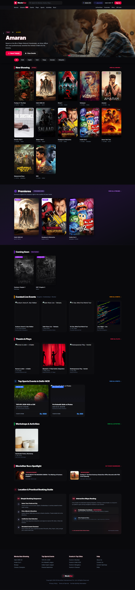

# MovieStar

MovieStar is a responsive, React-based movie and live-event discovery and ticket-booking demo. Visitors can browse a curated catalogue, choose a city, explore movies, sports, and events, and walk through a seat-selection and checkout experience.

## Overview

The app is built as a single-page experience with client-side view state. Movie, sports, and live-event listings are currently supplied by local mock data; most booking, account, and commerce interactions are front-end demonstrations rather than production services.

### Screenshot



The screenshot was captured from the running app at `http://localhost:3001/`.

### Features

- Browse movies, streaming titles, events, plays, sports, and activities.
- Search the catalogue and filter titles by language/category.
- Select a city to personalize listings.
- View movie and sports details, trailers, showtimes, and seat selection.
- Preview a checkout and ticket confirmation flow.
- Explore offers, gift cards, corporate booking, and event-submission screens.
- View demo admin and Java architecture panels.

## Tech stack

- **Frontend:** React 19, TypeScript, Vite 6
- **Styling and motion:** Tailwind CSS 4, custom CSS, Motion
- **Icons and UI:** Lucide React, React QR Code
- **Backend demo:** Node.js, Express, Zod, express-rate-limit
- **Database driver:** node-postgres (`pg`)

## Project structure

```text
src/
  App.tsx                 Main app shell and client-side view routing
  main.tsx                React entry point
  mockData.ts             Local movie, sport, and event catalogue
  types.ts                Shared TypeScript domain types
  index.css               Global styles and design utilities
  components/             Home, discovery, booking, and supporting screens
server/
  index.js                Optional Express API
docs/
  screenshots/
    home.png              Screenshot of the home page
```

## Getting started

**Prerequisites:** Node.js 20+ and npm.

```bash
npm install
npm run dev
```

Vite prints the local URL when the development server starts (normally `http://localhost:3000`). If that port is occupied, Vite selects another available port.

### Optional API server

In a second terminal, start the Express demo API:

```bash
npm run server
```

It listens on port `5000` by default. Configure `PORT`, `DB_USER`, `DB_HOST`, `DB_NAME`, `DB_PASSWORD`, and `DB_PORT` in a local `.env` file when using the booking endpoint. The API expects a PostgreSQL database with a `bookings` table; this repository does not include a database migration or schema. Do not use the server's fallback database credentials outside local development.

The demo API currently exposes:

| Method | Path | Purpose |
|---|---|---|
| `POST` | `/api/booking` | Validates and inserts a booking into PostgreSQL |
| `GET` | `/api/secure-data` | Example response showing whether an external API key is configured |

## Scripts

| Command | Description |
|---|---|
| `npm run dev` | Start the Vite development server |
| `npm run build` | Create a production frontend build in `dist/` |
| `npm run preview` | Preview the production build locally |
| `npm run lint` | Run the TypeScript compiler without emitting files |
| `npm run server` | Start the Express API |

`npm run build` succeeds. The current `npm run lint` check reports a pre-existing type error in `src/components/Home.tsx` (the `AnimatePresence` `mode` value `"crossfade"` is not supported by the installed Motion types). There is no automated test script configured in `package.json`.

## Project status

This repository is a UI/demo implementation, not a complete ticketing service. Catalogue content is local mock data, and the frontend booking flow is not wired to the Express API. Authentication, payment processing, persistent seat inventory, and production database setup are not implemented. Configure real integrations and add appropriate persistence, authorization, and operational safeguards before deploying as a customer-facing service.
